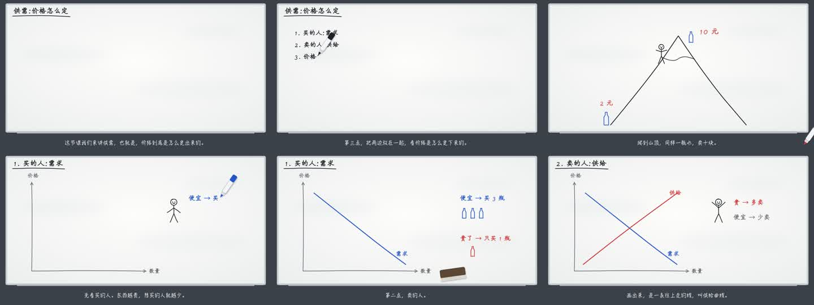

# 花伦解释视频 · hualun-explainer-video

> 让 Agent 把一个概念或一段故事，做成 1–3 分钟带配音和字幕的动画讲解视频。全部本地运行，不调用任何付费 API。




白板风 15 秒片段：[assets/board_15s.mp4](assets/board_15s.mp4)

**English summary:** An Agent Skill (Claude Code / Codex / Cursor, etc.) that turns a concept or a story into a 1–3 minute narrated explainer video with synced subtitles. The agent writes a storyboard as code, frames are rendered silently (Manim, or a headless-browser whiteboard where Chinese characters are drawn stroke by stroke), narration is generated by local TTS, and ffmpeg muxes it back with a per-sentence audio check. No paid APIs. Currently macOS-oriented and depends on a few companion pieces (see Requirements).

## 原理

AI 写分镜代码 → 逐帧算出无声画面，并记下每句旁白的开始时间 → 本地配音 → ffmpeg 按时间把每句贴回去，并逐句检查有没有声音 → 成片。

## 三条画面路线

| 路线 | 分镜 | 渲染脚本 | 适合 |
|---|---|---|---|
| 白板路线 | `分镜.js` | `scripts/render_board.sh` | 讲知识、讲原理（默认）。马克笔一笔一笔写：汉字按真实笔顺，英文/数字/公式用单线手写体，可擦全板或擦一块 |
| Manim 路线 | `分镜.py` | `scripts/render.sh` | 需要公式推导。4 套主题：`wanghong` 王虹手写风（默认）、`3b1b` 深色风、`retro` 美式复古、`pixel` 像素游戏风（带经验条） |
| 片段路线 | `分镜.json` | `scripts/render_clip.sh` | 搞笑经历、金句、科普、新闻、产品教程、数据走势。9 种语法：storytime 简笔角色、纸片剧场、动态文字、扁平科普、Vox 拼贴、白板、3B1B、发布会界面、财经图表；自动配音效和背景音乐 |

## 依赖

目前按 macOS 写的。脚本默认从下面的位置找依赖，大部分可以用环境变量改。

| 部件 | 默认位置 / 环境变量 | 用途 |
|---|---|---|
| Python + Manim | `~/Tools/envs/learning-video`（`EXPLAINER_VENV`） | Manim 路线 |
| TinyTeX（fontspec、unicode-math、lm-math） | `~/Library/TinyTeX` | 仅 Manim 公式排版 |
| ffmpeg | Homebrew | 贴配音、量时长、核对 |
| Node.js + playwright-core、hanzi-writer-data、hersheytext | `~/Tools/envs/whiteboard-video/node_modules`（`WHITEBOARD_DEPS`） | 白板路线 |
| Playwright 无头 Chromium | `~/Library/Caches/ms-playwright/` | 白板、片段路线截图 |
| Fusion Pixel 像素字体（OFL） | `~/Library/Fonts/` | 仅像素风 |
| 本地配音 Skill `hualun-local-tts` | `~/.hermes/skills/hualun-local-tts/` | 旁白：`clone` 克隆声音（VoxCPM2）或 `--tts edge` |
| 片段路线引擎：花叔 huashu-art-motion 的副本（MIT） | `~/Tools/apps/花伦动画引擎`（`HUASHU_ENGINE`） | 仅片段路线 |
| 音效 / 音乐素材库 | `HUALUN_VIDEO_PROJECT` | 仅片段路线的自动音效 |

> ⚠️ 配音 Skill、片段路线引擎和音效素材库**不在本仓库里**，需要另外准备。

## 安装

把整个文件夹复制到你 Agent 的 skills 目录，例如：

```bash
git clone https://github.com/JasonHualun/hualun-explainer-video
cp -R hualun-explainer-video ~/.claude/skills/   # Claude Code；Codex、Cursor 等放到各自的 skills 目录
```

然后跟 Agent 说：「做个视频讲讲供需关系」「白板讲解」「动画讲解」等等。

## 快速开始

```bash
# 白板路线：先出草稿，再出成片
bash scripts/render_board.sh examples/supply_demand_board.js --draft
bash scripts/render_board.sh examples/supply_demand_board.js --final

# Manim 路线（换主题：EXPLAINER_THEME=3b1b / retro / pixel）
bash scripts/render.sh examples/supply_demand.py SupplyDemand --draft
```

`--final` 可加 `--tts edge` 切换配音。实际使用时建议把分镜放在单独的集目录里。完整写法见 [SKILL.md](SKILL.md)，动画方法论见 [references/动画方法论.md](references/动画方法论.md)。

## 目录结构

```
SKILL.md                 Skill 主说明（Agent 读这个）
references/动画方法论.md   选风格、导演方法、验收
examples/                供需关系示范分镜（白板 .js / Manim .py）
scripts/
  render.sh              Manim 路线
  render_board.sh        白板路线
  render_clip.sh         片段路线
  explainer.py theme.py doodles.py   Manim 场景、主题、简笔画
  board/                 白板引擎（网页 + 逐帧截图）
  clip/                  片段路线规划、渲染、音效
  prepare_audio.py board_audio.py mux_audio.py audio_key.py   配音与合成
assets/                  预览图
```

## 致谢

- 片段路线的 8 种解说语法来自 花叔 huashu-art-motion（MIT）
- 汉字笔顺数据 hanzi-writer-data（Arphic 开源字形）、单线字体 hersheytext、Manim、Playwright、ffmpeg

## 许可

[MIT](LICENSE) © 2026 Hualun

## 作者

花伦 · X [@JasonChen51](https://x.com/JasonChen51) · GitHub [JasonHualun](https://github.com/JasonHualun)
